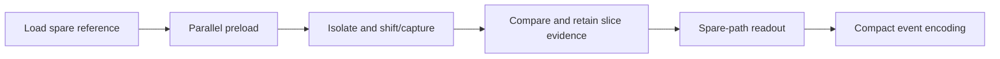

# TDF_diag
### On-chip scan-path diagnosis with failure-time evidence preservation

A scan test can report a failure without telling us where the scan path went wrong. Intermittent faults make this harder: the fault may disappear before external diagnosis can reproduce it.

TDF_diag studies an on-chip approach that **compares scan transfers against a spare/reference path and retains compact mismatch evidence for later readout**. Instead of preserving every chain's full response, it localizes a failing slice within a group of chains.

This repository provides behavioral RTL, self-checking testbenches, software diagnosis models, and example results. It supports studying the diagnosis sequence, localization-versus-hardware trade-off, and compact evidence encoding.

## Design overview



For a full group of Nsp target chains, a slice indication leaves Nsp chain candidates at that slice. Smaller groups provide finer localization; larger groups share more spare-path hardware. Multiple faults in one slice can merge into one indication.

Read [Architecture](docs/ARCHITECTURE.md) for the sequence, modules, and evidence format.

## The central idea

Diagnosis should preserve what happened when the fault was active, rather than depend entirely on reproducing it later. A qualified spare path provides reference state and a route for retaining and reading mismatch indications. Parallel preload avoids relying on serial propagation through the target path before the controlled shift/capture exposes a fault effect.

The design deliberately trades chain identity for compact spatial evidence: an indicated slice identifies a small suspect group rather than one guaranteed faulty cell. Group size controls that localization cost. A separate bounded event encoder compresses nonzero indications for a surrounding storage system. These are complementary building blocks: the scan mechanism captures evidence, while grouping and encoding determine how much detail survives readout.

## Quick start

Python checks require Python 3.10+ and Make, with no third-party Python packages:

```sh
make test
make summarize
```

The tests check fault and observation models. The summary command reads supplied data and generates suspect-count, precision, recall, timing and logger summaries under `results/summary/`.

For RTL, install Icarus Verilog or configure licensed Synopsys VCS on PATH:

```sh
python3 scripts/run_rtl.py
# Select a simulator and a smaller suite:
python3 scripts/run_rtl.py --simulator vcs --cases core logger
```

Each testbench builds in its own `build/` directory and checks explicit PASS/FAIL markers. The verification record includes 57 passing Python tests and six passing RTL suites with VCS. The Icarus command path is provided but was not validated in this environment.

## What you can explore

| Experiment | Question |
|---|---|
| Core scan transfer | Does a captured mismatch appear at the expected position? |
| Permanent/intermittent fault effects | Does evidence reflect the fault active at capture? |
| Multi-bank grouping | How are target chains assigned to spare banks? |
| Slice compression | What information remains after chain-level OR compression? |
| Compact logger | How do event count and capacity affect storage and overflow? |
| Software reference models | How do suspect sets and diagnosis metrics change with multiplicity? |

[Experiments](docs/EXPERIMENTS.md) lists commands, configurations, outputs and expected observations.

## Repository layout

| Path | Contents |
|---|---|
| `rtl/`, `tb/` | Core, grouping/compression, encoder and testbenches |
| `diagnosis/` | Software fault models, observation-driven diagnosis and sweeps |
| `scripts/` | Run, summarize and integrity-check tools |
| `evidence/` | Raw trials, RTL outputs, timing/area reports, verification records |
| `eda/original/` | EDA script references requiring external setup and libraries |
| `docs/` | Architecture, experiments and data descriptions |

RTL examples use a 72-position core. The supplied one-dimensional software sweep uses five 1,000-cell chains; the separate 2D model uses a 71-by-71 array with 5,000 active cells. [Data](docs/DATA.md) explains these configurations and metrics.

## Scope

The executable examples validate behavioral diagnosis and compact record encoding. Fault effects are injected in simulation. The logger produces a packed 512-bit output; persistent SRAM integration and a complete autonomous diagnosis controller are outside this package. Timing and area files are supporting reports, not a turnkey physical-design flow.

## Research

**On-Chip Scan-Path Diagnosis with Failure-Time Evidence Preservation**

Jincheol Jeong, Sungyoul Seo, Jongsoo Yim, and Hayoung Lee

A distribution license has not yet been assigned.
